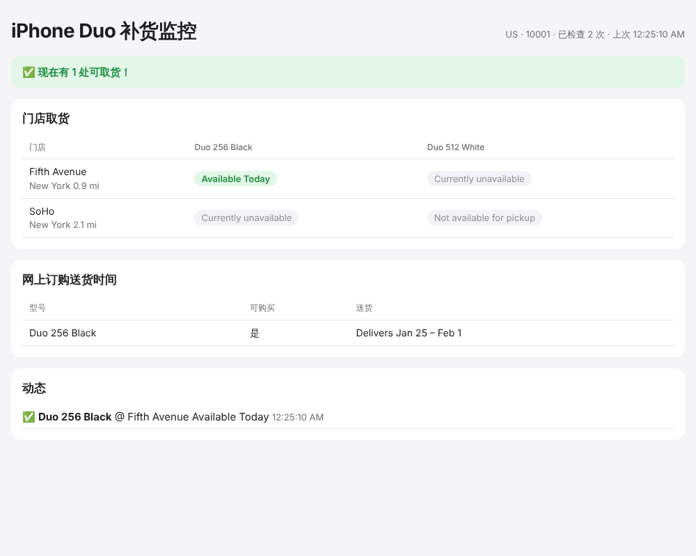

# iPhone Duo 补货监控

监控 Apple Store 官网上 **iPhone Duo** 的门店取货情况。一有货就推送到手机或电脑，同时带一个本地网页看板，实时显示各门店的库存。

- ✅ **门店取货监控**：可以同时监控多个型号，覆盖附近所有门店，或只看你指定的几家
- 🏷️ **内置型号号码**：10 个地区、8 种容量和颜色组合都已内置，配置里写 `512gb` + `nightsky` 就行，不用自己去官网找号码
- 🔔 **9 种通知渠道**：Bark（iPhone 推送）、Server 酱 / PushPlus（微信）、Telegram、ntfy、Discord、自定义 Webhook、邮件、电脑弹窗和提示音
- 🖥️ **网页看板**：门店 × 型号的有货表格、补货动态记录，浏览器里也能弹提醒、响提示音；还能直接在页面上点按钮调整查询间隔和每天的监控时段，马上生效并保存到 `config.toml`
- 🌏 **多地区**：美国、中国大陆、香港、台湾、日本、新加坡、加拿大、英国、澳大利亚
- 🛡️ **防拦截**：像浏览器一样先拿会话 cookie，每轮只发一个请求；被 Apple 拦截后冷却 5 → 10 → 20 → 30 分钟再试；只在状态变化时推送，不会刷屏
- 📦 **零依赖**：只需要 Python 3.11+，不用装任何第三方库



## 快速开始

```bash
git clone https://github.com/richardB520/Iphone-DUO-restock.git
cd Iphone-DUO-restock
cp config.example.toml config.toml   # 然后编辑 config.toml
python3 -m duo_restock check         # 先检查一次，确认配置正确
python3 -m duo_restock test-notify   # 测试推送能不能收到
python3 -m duo_restock run           # 开始持续监控
```

运行后打开 <http://127.0.0.1:8765> 就能看到网页看板。看板是 `run` 命令自己启动的，所以终端窗口要一直开着；如果浏览器显示 “refused to connect”，说明监控程序没在运行，或者启动时报错退出了，看一下终端里的输出。

> **Mac 用户注意**：系统自带的 `python3` 是 3.9，版本太旧，请先 `brew install python@3.12`，然后用 `python3.12` 运行上面的命令。
> 也可以直接在 Finder 里双击 `start.command`：它会自动找合适的 Python，第一次运行时生成 `config.toml`，之后会启动监控并打开看板。
> 如果双击后提示「无法验证开发者」，右键点 `start.command` → 打开。

也可以先安装成命令：`pip install .`，之后直接用 `duo-restock run`。

## 选择型号

程序已经内置了 iPhone Duo 在各地区的型号号码，在 `config.toml` 里写容量和颜色就行：

```toml
[[products]]
capacity = "512gb"     # 256gb / 512gb / 1tb / 2tb
color = "nightsky"     # nightsky（Night Sky）/ starwhite（Star White）
```

想监控几个组合就写几个 `[[products]]`。运行 `python3 -m duo_restock models` 可以查看当前地区的全部型号号码。

如果以后 Apple 出了新颜色、内置表里没有，也可以直接写 `part = "MXXXXLL/A"`。找号码的方法：在官网购买页选好型号，打开浏览器开发者工具的 Network 标签，点「查看门店是否有货」，在 `pickup-message` 请求里找 `parts.0=` 后面的值（`%2F` 就是 `/`）。

## 配置说明

完整示例和注释见 [`config.example.toml`](config.example.toml)，主要有这几项：

| 配置 | 说明 |
| --- | --- |
| `apple.region` | 地区：`us` `cn` `hk` `hk-zh` `tw` `jp` `sg` `ca` `uk` `au` |
| `apple.location` | 美国填邮编，例如 `10001`；中国大陆填「省 市 区」，例如 `上海 上海 黄浦区` |
| `apple.store` | 也可以只查一家门店，填门店编号，例如 `R095` |
| `apple.store_filter` | 只关心哪些门店，例如 `["R095", "R227"]` |
| `monitor.interval_seconds` | 检查间隔，默认 180 秒。每轮所有型号合成一个请求。Apple 每个 IP 每小时大约只放行 30 次，低于 150 秒会周期性被拦 |
| `monitor.active_hours` | 每天只在这个时间段监控，例如 `["05:00", "10:00"]`（电脑本地时间），其余时间不发请求；不写就是全天 |
| `monitor.remind_minutes` | 一直有货时每隔多少分钟再提醒一次，0 表示只在刚补货时提醒一次 |
| `monitor.notify_sold_out` | 卖完时是否也推送 |
| `dashboard.host` | 改成 `0.0.0.0` 后，同一 Wi-Fi 下的手机也能打开看板 |

### 推荐的通知设置

- **iPhone 用户**：用 [Bark](https://apps.apple.com/app/bark-customed-notifications/id1403753865)，把 `level` 设成 `critical`，静音模式下也会响
- **微信**：用 [Server 酱](https://sct.ftqq.com) 或 [PushPlus](https://www.pushplus.plus)
- **安卓 / 跨平台**：用 [ntfy](https://ntfy.sh)，不用注册，起一个不容易被别人猜到的 topic 名就行

推送里会带上购买链接，点开就能直接下单。

## 命令

| 命令 | 作用 |
| --- | --- |
| `python3 -m duo_restock run` | 持续监控，同时启动看板（加 `--no-dashboard` 就不启动看板） |
| `python3 -m duo_restock check` | 只检查一次，把结果打印出来，不推送 |
| `python3 -m duo_restock test-notify` | 给所有已启用的渠道发一条测试消息 |
| `python3 -m duo_restock models` | 列出内置的 iPhone Duo 型号号码（可以加地区，例如 `models cn`） |
| `python3 -m duo_restock url` | 打印实际请求的 Apple 接口地址，可以贴到浏览器里排查问题 |

所有命令都可以加 `-c 路径` 指定别的配置文件，加 `-v` 输出调试日志。

## 长期在后台运行

监控程序需要一直开着，并且要在你自己的电脑或家里的网络上运行：Apple 经常屏蔽云服务器和数据中心的 IP。

```bash
# macOS / Linux：关掉终端也继续跑
nohup python3 -m duo_restock run > monitor.log 2>&1 &

# 或者放进 tmux / screen 里
tmux new -s duo 'python3 -m duo_restock run'
```

Mac 记得在「系统设置 → 电池」里关掉自动睡眠，不然电脑睡着了就收不到提醒。

如果设置了 `active_hours`、晚上想让 Mac 睡觉，可以让它每天定时自己醒来（需要输入开机密码）：

```bash
sudo pmset repeat wakeorpoweron MTWRFSU 04:55:00   # 每天 4:55 唤醒
pmset -g sched                                    # 查看已设置的计划
sudo pmset repeat cancel                          # 取消
```

定时唤醒后，Mac 要接着电源、保持亮屏或防睡眠，才能一直跑到 10 点。

## 常见问题

**一直显示 `HTTP 541` / `403` / `429`？**
这是被 Apple 拦截了。实测 Apple 按出口 IP 计数，**每小时大约只放行 30 次查询**：间隔 60 秒和 120 秒都是在第 30 次左右被拦，然后要停 15 到 30 分钟。默认间隔 180 秒（每小时 20 次）留有余量。程序被拦后会自动冷却 5 → 10 → 20 → 30 分钟再试。**同一个网络下的其他补货监控程序、频繁刷新官网也会占用同一份额度**，所以只留一个监控程序在跑。

**为什么不用 `fulfillment-messages` 接口？**
很多旧教程和项目用的是这个接口，但它现在要求带上浏览器脚本生成的验证令牌，程序直接请求一律返回 541。本程序改用官网「查看是否有货」实际调用的 `retail/pickup-message` 接口，并且先访问购物袋页拿到会话 cookie，就像浏览器那样。

**显示「尚未开放取货」？**
Apple 还没开放这个型号的到店取货时，所有门店都会这样显示。这不是无货，开放后会自动变成有货或无货。

**`check` 显示 “Apple returned no stores”？**
通常是 `location` 填错了，或者手动填的 `part` 和 `region` 不匹配（美国号码以 `LL/A` 结尾，中国大陆以 `CH/A` 结尾）。可以用 `url` 命令打印出接口地址，贴到浏览器里看 Apple 实际返回了什么。

**第一次运行就推送了？**
这是正常的：如果启动时已经有货，会马上提醒你。之后只在状态发生变化时才推送，已经推送过的状态记在 `state.json` 里，重启也不会重复推送。

## 开发

```bash
python3 -m unittest discover -s tests -v
```

代码结构：

```
duo_restock/
  apple.py        Apple 取货接口：会话 cookie、请求头、解析返回的 JSON
  catalog.py      内置的 iPhone Duo 各地区型号号码
  monitor.py      轮询循环：和上次状态比较，决定要不要推送，失败时退避
  notifiers.py    各种推送渠道
  dashboard.py    本地网页看板（dashboard.html）
  config.py       读取并校验 config.toml
  cli.py          命令行入口
```

## 致谢

接口地址、会话 cookie、请求预算和冷却策略，以及内置的型号号码，参考了 [ENCHIGO/apple-pickup-watcher](https://github.com/ENCHIGO/apple-pickup-watcher) 的研究和数据（本项目没有复制它的代码）。如果你想要带图形界面、覆盖 iPhone 以外产品的桌面版，可以直接用它。

## 声明

本项目和 Apple 没有任何关系，只是读取 Apple 官网公开的库存查询接口，供个人使用。请保持合理的检查频率，不要用来大规模抢购或倒卖。Apple 的接口随时可能变化，如果哪天失效了，欢迎提 Issue。
